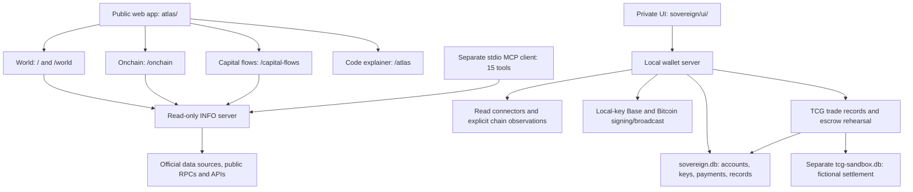

# Cashloom: current implementation map

Observed locally on 2026-09-23. This is a source and local-verification map,
not a roadmap or a statement about the current hosted deployment.

This survey records the **pre-integration** state. Subsequent changes and final
verification are recorded in the
[connected-experience report](experience-integration-2026-09-23.md); counts,
navigation gaps, and initial test findings below belong to this earlier survey.

Checkout: `/Users/yu/Desktop/cashloom`, branch
`feature/capital-flows-20260909`, HEAD
`e421a1ac4a3e397d0afb8ae65efe2cb5580a515c` (September 9).
Before this map was added, the checkout had 22 modified tracked files and 58
untracked files. Capital flows and TCG Trades are substantial existing
uncommitted work. None of that application work was changed during this survey.

**The shape of the project**

Cashloom has two runnable applications: a public money-information surface and
a private local wallet. Both use parts of `sovereign/src`, but have distinct
entrypoints and frontend applications. The public INFO entrypoint excludes the
wallet database, key vault, and payment senders from its import graph. The local
wallet also mounts the public information APIs alongside its private routes.



Entry points: [public server](../sovereign/src/info-server.ts),
[private server](../sovereign/src/index.ts),
[public route switch](../atlas/src/App.tsx),
[private navigation](../sovereign/ui/src/App.tsx).

**What a person can use**

| Surface | Current behavior | Boundary |
|---|---|---|
| World, `/` or `/world` | Today briefing; policy and cash rates; selected sovereign yields; FX and BTC/ETH references; fees; policy-meeting calendar; source receipts; local Watching preferences | Read-only, partial coverage, no account required. Missing and rights-withheld data stay explicit. |
| Onchain, `/onchain` or `/blockchain` | Network observations, native USDC supply, selected Aave lending and Uniswap pools, CCTP fee references | No wallet connection or execution. These observations do not establish reserve backing or global capital flows. |
| Capital flows, `/capital-flows` | Reported financing/transactions, category filters, bounded publisher histories, detailed source receipts | Implemented in this checkout; documentation explicitly says unpublished. No global total, live market tape, or archived data vintages. |
| Atlas, `/atlas` | Interactive wallet architecture, source overlays, decisions and roadmap | A code explainer, not the operational wallet UI. Snippets are imported at build time. |
| Private wallet | Overview, Pay, Receive, Trades, Ledger, Accounts, Connections, Keys, zerone | Owner-controlled local runtime. Most private navigation is component state rather than separate URL routes. |

**Public data and machine access**

World's `/v1/world?base=...` aggregates independent readers. Source failures can
leave a partial response rather than invalidate the entire dashboard. Its eight
currency lenses are USD, EUR, GBP, JPY, CHF, CAD, AUD and CNY.

Current source families include BIS policy rates, US Treasury yields, ECB
modelled euro-area yields, Japan MOF JGB yields, NY Fed cash rates, Federal
Reserve monetary-policy RSS, ECB FX, Ethereum oracle feeds for BTC/ETH,
Blockstream fee observations, and Base RPC fee observations. Meeting dates are
checked-in 2026/2027 transcriptions, verified August 20, 2026; they are not
continuously fetched calendars. Verification degrades after 45 days.

World's research entries for oil/currency relationships and conflict/energy
effects are explanatory unavailable placeholders. Brent/WTI and UK yield
values are withheld; there is no correlation or event-study engine behind
those entries.

Onchain uses a fixed registry: eight networks, native USDC on six, Aave V3 and
Uniswap V3 on Ethereum/Base/Arbitrum/Optimism, and ten Ethereum-to-spoke CCTP
directions. That is selected coverage. Public address-balance API support is
narrower: Bitcoin and Zerone.

Capital flows has four source adapters:

| Adapter | Reported population |
|---|---|
| US Daily Treasury Statement | Daily cash debt issues, redemptions and net financing |
| ECB sovereign issuance | Monthly Spain/Germany central-government face-value issuance, redemptions and net |
| US Treasury TIC | Monthly foreign purchases, sales and net transactions in selected US long-term securities |
| ECB investment funds | Quarterly euro-area non-MMF equity, bond, real-estate and private-equity fund-share transactions |

Capital values preserve native USD/EUR millions, exact decimal quantities,
reporting periods and dimensions. Fund domicile is not investor residence or
the destination of underlying investments. No current FX conversion is applied
to historical periods, and no worldwide total is constructed from these series.

| Cache | Server behavior | Browser behavior |
|---|---|---|
| World | Per-currency RAM cache; 10-second freshness, bounded five-minute stale delivery, one rebuild at a time, failure backoff | Validated public snapshots retained up to 24 hours; separate local currency/star/filter preferences; active-view refresh |
| Onchain | Bounded snapshot work, 20/30-second freshness by state, two-minute stale window | Validated public snapshots retained up to 24 hours; active-view refresh |
| Capital flows | Independent request pool and RAM cache; hourly daily-source rechecks, six-hourly monthly/quarterly rechecks; last-good receipts retained at most seven days | Memory only, bounded completion checks; no persistent snapshot storage |

Capital reads stay outside World's aggregation. Enabled history limits are
60 daily, 24 monthly and 20 quarterly observations per series. Weekly/event
model shapes exist without enabled sources. Histories are publishers' current
revised series, not a historical archive of each publication vintage. RAM
fallbacks disappear on process restart.

Public HTTP additionally exposes discovery, assets, chain balances, FX, fiat
conversion, fees, prices, holding valuation, portfolio reports, cash rates,
Fed announcements, and Zerone status/truth reads. XENIA Surface's three
declared deterministic resources are orientation, rights and data practices;
dashboard APIs are discoverable beyond that narrow scope. The rights adoption
record is a draft, not an activated attestation.

The separate [MCP program](../sovereign/src/mcp/moneyworld.ts) exposes 15 stdio
read tools through an HTTP node selected by `MONEYWORLD_URL` (loopback by
default). It covers balances, FX, prices, valuation/portfolio, conversion,
fees, assets and Zerone. It has no dedicated World, Onchain or Capital flows
tools and is not a hosted MCP endpoint in INFO.

Source hubs: [World aggregation](../sovereign/src/info/world-door.ts),
[macro sources](../sovereign/src/info/macro-sources.ts),
[Onchain registry](../sovereign/src/info/blockchain/registry.ts),
[Capital registry](../sovereign/src/info/capital-flows/registry.ts),
[Capital cache](../sovereign/src/info/capital-flows/snapshot.ts),
[discovery](../sovereign/src/info/xenia-surface.ts).

**The private wallet**

`bun start` in `sovereign/` starts the Bun/Hono wallet, normally on
`127.0.0.1:4747`. It rejects non-loopback custody binding and applies Host/Origin
checks. SQLite defaults to `~/.cashloom/sovereign.db`, overridable through
`CASHLOOM_DATA_DIR`. No live wallet files were opened for this survey.

The vault generates/imports EVM and Bitcoin keys, seals them using an
Argon2id-derived AES-GCM key, and performs typed local signing. It uses scoped,
expiring sessions (15 minutes by default); locking clears the master key and
sessions. The browser keeps its session token in memory and sessionStorage.
Vault key encryption does not encrypt the whole database or trade history.

Implemented outbound rails are Base ETH, native Base USDC, and Bitcoin mainnet
single-key P2WPKH. The flow is:

```text
Exact account/asset identity → five-minute quote → owner confirmation
→ resource reservations and one-use authorization
→ durable signed transaction bytes → broadcast → evidence/reconciliation
```

Unknown broadcast outcomes retain their uncertainty. Recovery uses the durable
bytes; it does not create a fresh payment automatically. The Wallet Kernel
stores intents, authorizations, resource claims, signed artifacts, executions,
receipts, observations and balanced journal evidence.

Base has additional two-provider finalized reconciliation and ETH/native-USDC
position observation. Reading saved positions is local; explicit refreshes use
the network. Conflicting same-height snapshots freeze the view. An optional
reconciliation scheduler is disabled by default and can observe/settle existing
signed work, not sign or broadcast new payments. Bitcoin does not have the same
rich Base position/finality machinery.

Read connectors are Stripe, GoCardless, Esplora, Alchemy and AgentTool.
Explicit account sync imports balances/history with validation and transaction
deduplication. Account records contain allowed environment-variable names for
credentials, not the credential values. The connector interface has no outbound
payment method; that does not imply every underlying provider credential is
intrinsically read-only.

External connectivity is implemented at the adapter/contract level:
WebAuthn, hardware EVM verification, WalletConnect v2, ERC-4337 v0.7,
GoCardless bank-data linking and Yapily preparation/status. Every integration
catalogue entry currently has `execution_enabled: false`. The atomic owner
coordinators required to join external verification to core artifacts are not
enabled. Connections is a local inspection page, not a completed connect/pay flow.

Agent proposal/authorization plumbing exists, but the agent-confirm HTTP route
currently refuses execution. Base's core also refuses agent authorization where
estimated L1/operator costs cannot satisfy a hard authorized fee bound.

UI details that prevent overclaiming:

- Overview sums legacy account balances by currency. Finalized Base evidence
  lives in a separate Accounts panel and v3 API; this is not yet one uniformly
  reconciled and deduplicated portfolio.
- Manual ledger entries append transaction history; their handler does not
  update the account balance.
- Receive copies public addresses; there is no QR generator.
- Exact-byte recovery has an API route; the payment UI describes availability
  rather than offering the complete recovery action.
- There is no passphrase recovery mechanism or Bitcoin fee-bump UI.

Source hubs: [API and gates](../sovereign/src/index.ts),
[vault](../sovereign/src/vault.ts), [payments](../sovereign/src/pay.ts),
[kernel schema](../sovereign/src/wallet/infrastructure/sqlite/schema.ts),
[Base positions](../sovereign/src/wallet/base-position-service.ts),
[integration catalogue](../sovereign/src/wallet/integration-catalog.ts).

**TCG Trades in this checkout**

This is a private shipped-card/bundle agreement workspace plus a separate
no-money escrow rehearsal. It is not an escrow service or marketplace.

Trade records support buyer/seller labels, card/printing/condition/grading
claims, exact single-asset consideration, shipping and inspection/dispute
terms, immutable revisions, append-only evidence/corrections, and history.
Acceptance/payment/delivery claims remain bound to the revision they concern.
They do not establish independent-party consent or verified real-world events.
Reference valuations can be recorded through the API and displayed, but there
is no valuation-entry form or automated catalog/pricing ingestion.

A chosen revision can be copied into a persistent simulation. One local owner
plays every role. The state machine supports acceptance, fictional funding,
dispatch, delivery, inspection, full release, disputes, authorized returns,
full refunds, cancellation and uncertain operations. Unknown outcomes retain a
stable operation ID for reconciliation. Source edits never silently change the
simulation's copied agreement. Dispatch and elapsed time do not release funds.

Records use five additive `tcg_*` tables in `sovereign.db`; simulation uses three
tables in a separate, lazily created `tcg-sandbox.db`. Reads do not create an
unused sandbox. Code and database connections enforce the separation; it is
not OS-process isolation.

`/api/tcg/trades` and `/api/tcg/simulations` require a local owner plus the
appropriate `trades:read`, `trades:write`, or `trades:simulate` scope. Responses
are private/no-store. Version checks and idempotency keys protect writes. The
UI retains exact uncertain-request retries in memory while the view stays
mounted; leaving it or locking clears that retry and unsaved forms. Lists and
history have explicit pagination.

There is no real custody, protected funding, independent remote-party
authentication, executed release/refund provider, card authentication,
adjudication service, uploads, partial refund, or marketplace/chat flow.

Source hubs: [TCG guide](../TCG.md), [record store](../sovereign/src/tcg/store.ts),
[simulation](../sovereign/src/tcg/simulation.ts),
[routes](../sovereign/src/tcg/routes.ts),
[workspace UI](../sovereign/ui/src/views/Trades.tsx).

**Build, deployment and older material**

There are three dependency/build units: `atlas/` (React 18/Vite), `sovereign/`
(Bun/Hono/SQLite), and `sovereign/ui/` (React 19/Vite). CI covers backend typecheck
and tests, wallet UI tests/build, Atlas tests/build, and a public INFO container
audit/smoke test.

The [Dockerfile](../Dockerfile) builds one bundled INFO program; its final image
is designed to contain that program and public rights documents, excluding
wallet source/state. [.dockerignore](../.dockerignore) allowlists the public
source graph. [fly.toml](../fly.toml) configures the `cashloom-api` service in
London. [Pages middleware](../atlas/functions/_middleware.ts) forwards public
GET/HEAD/OPTIONS requests to that API, without cookies, authorization headers or
write requests. [Amplify configuration](../amplify.yml) is an alternate frontend
build pointing directly at the public API. These files do not prove deployment
or the currently hosted revision; no remote deployment was inspected.

[tools/loom-snapshot.sh](../tools/loom-snapshot.sh) can fetch public facts and
upload dated files/manifests to object storage using scoped Keychain reads.
Its existence/comment does not prove a currently running schedule or successful
uploads. It was inspected, not executed.

`backend/` and `client/` have no tracked files on this branch; local ignored
dependency/build remnants remain. The old finance-tracker statements in
`VISION.md` (such as receipt scanning and AI insights) are not a description of
an active tracked application here. `STATE.md` is a July snapshot whose clean
state and old commit disagree with today's checkout. `PROTOCOL.md`, `INFORM.md`
and the historical section of `MONEYWORLD.md` mix design/history with implemented
work; source and current guides are needed to distinguish them.

Lightning, additional payment rails, payment pointers, fiat sending, general
CSV/receipt import, recurring/invoice products, desktop packaging, and universal
coverage are not current completed product flows. MCP's transport-error advice
still says `bun start`, which starts the wallet; the current public guide
correctly selects `src/info-server.ts`.

**Verification performed during this survey**

Checks used existing installed dependencies, clean child environments,
disposable HOME/data directories, and an OS loopback-only network restriction.
The wallet UI harness copied exact lockfile versions from the local cache into
its fixture. No dependencies were installed, live wallet opened, payments made,
provider integrations activated, or remote deployment queried.

| Check | Current result |
|---|---|
| Atlas TypeScript | Passed |
| Atlas tests | 160 passed |
| Sovereign TypeScript | Passed |
| Covenant draft schema validation | Valid, no issues; this is not activation |
| INFO/connectors/util tests | 923 passed, 1 failed, 1 skipped |
| Vault/sync/pay/senders/Zerone node tests | 83 passed |
| Mounted private API tests | 18 passed |
| TCG backend tests | 55 passed |
| Wallet Kernel tests | 181 passed |
| Agent-pay tests | 11 passed |
| Wallet UI tests | 65 passed |
| Wallet UI TypeScript and exact-lock Vite build | Passed |
| TCG browser journeys | 13 checkpoints passed |

Total: **1,496 passing tests, one failing test and one skipped test**, plus the
13 passing browser checkpoints. The failing
[`fx.test.ts`](../sovereign/src/info/fx.test.ts) embeds an August 20 FX reference
date while the current route applies a three-business-day freshness gate. The
test expects a fact but receives a refusal. This existing failure is also
recorded in `TCG.md`; it was reproduced and left unchanged.

Browser journeys exercised real built wallet UI and TCG routes/stores with
synthetic authentication/wallet data, including release/refund, exact retry,
restart reconciliation, 101-record pagination, private storage clearing and
unchanged wallet fixture tables. Desktop and mobile screenshots were inspected.
Separate private API tests covered actual vault/session/scope integration.

These results establish local behavior within the tested scope. They do not
verify current upstream data, live payments, current hosted assets, container
execution, or public-page browser interaction. Atlas production build and the
Docker CI job were not run in this survey.
