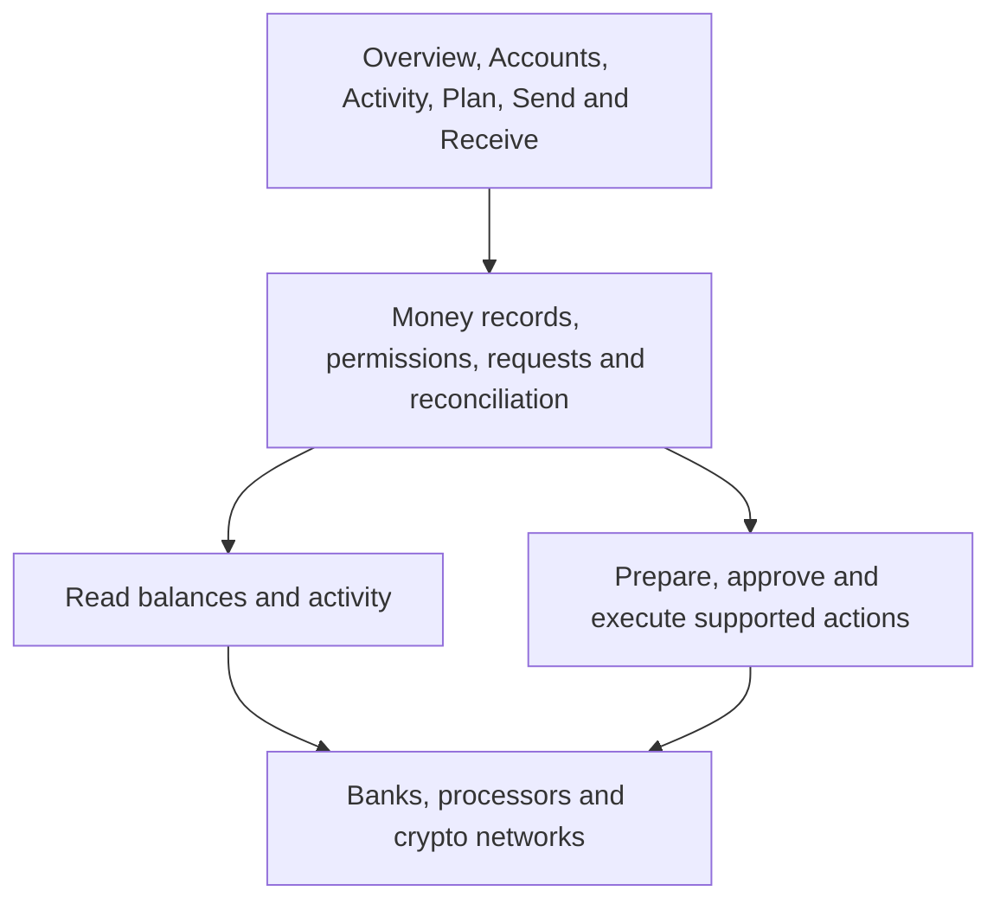

# CashLoom Connect: US-first integration proposal

Brainstorm, source review, and first local implementation, 29 September 2026.
The user selected **US first, then expand** and approved starting the work.
The read layer below is implemented locally; provider access and live bank
connections have not been activated. Later payment phases remain proposals.

## First implementation

- One additive read model extends the existing accounts and transactions. It
  stores provider/environment, freshness, available/pending/held amounts,
  transaction revisions and removals, and reviewed transfer links. Existing
  Stripe and crypto readers use the same commit path. No third ledger.
- Private **Connections** shows actual saved status, permissions and freshness;
  **Accounts**, **Overview**, and **Activity** retain sandbox labels. Credit-card
  debt and available credit are distinguished from cash.
- A **Plaid sandbox** journey creates Link on explicit owner action, exchanges
  a one-use public token, seals the access token with the vault, and imports
  supported USD checking/savings/credit-card accounts. A requested sync applies
  all transaction pages and the next cursor in one transaction. Provider changes
  preserve local categories; pending replacements and removals retain history.
- **Reviewed CSV import** into manual accounts supports exact signed amounts, a destination-bound
  preview, duplicate detection, and atomic confirmation. It does not update an
  observed balance. **JSON export** uses an explicit record allowlist and excludes
  raw provider payloads, external identifiers, credentials and signing material.
  Follow-up review lets the owner preserve an individual matching row as a
  separate transaction using a stable reference and a fresh preview. Replays
  skip the same reference; conflicting reuse is refused.
- **Transfer review** suggests nearby equal-opposite records and requires the
  owner to confirm both accounts and entries. Confirmed transfers are excluded
  from income/spending; review can be undone. Fee and currency-conversion
  differences need a later matching model. Stripe records retain gross, fee and
  net values so a receipt and its fee are counted separately.
- Reads of saved state do not contact providers. A disconnected source retains
  its saved history; further provider refreshes stop immediately, and failed remote revocation
  remains visible and retryable. Reconnection currently requires a reviewed
  disconnect and a new Link session, rather than Link update mode.

The implementation is a sandbox-capable local pilot, not a production bank
connection service. Automated verification uses isolated databases, synthetic
records and mocked providers. Plaid's real sandbox has not been exercised with
operator credentials. Production access, provider approval, webhooks, scheduled
bank catch-up, PayPal/Cash App connections, and new bank-payment execution remain
unimplemented. Existing crypto payment boundaries are unchanged.

See [local setup](../sovereign/README.md#unified-money-view-local-pilot) and the
[read-layer contracts](../sovereign/src/connect/contracts.ts).

Verification: 59 read-layer tests, 35 private API tests, 131 private UI tests,
and 230 public UI tests pass, with TypeScript checks and both production builds.
The existing connector, vault, payment, wallet, trade and local-backup suites
also pass; the opt-in live-data test remains skipped. Browser checks cover 16
public checkpoints, 22 synthetic private journeys, 8 isolated actual-node and
recovery checks, and the new connection/import/export/transfer flow. Provider
traffic in integration checks is mocked; these results do not establish live
provider access.

## Product purpose

One place to understand money across institutions, give it a purpose, and take
supported actions with clear permission and evidence. Keep the interface named
**Connections**; **CashLoom Connect** is a working name for the underlying layer.

Four jobs should stay consistent across providers:

- **See:** accounts, assets, liabilities, balances, history, and freshness.
- **Organise:** categories, plans, commitments, and transfers between owned accounts.
- **Move:** prepare an eligible payment, review costs and destination, approve,
  then track its actual outcome.
- **Receive:** offer an eligible payment request or merchant checkout, associate
  incoming evidence with it, and explain fees, availability, refunds and disputes.

A planning set-aside remains a plan unless the person explicitly moves money.
An estimated combined value is distinct from money available to spend. Keep USD,
USDC on a named network, and other assets distinct, even when displaying USD
estimates. Show provider timestamps and conversion timestamps.

## US provider shortlist and evidence

The following are integration candidates, not commitments or verified access for
CashLoom. Sources were read on the date above.

| Connection | First useful capability | Boundary |
|---|---|---|
| US banks via Plaid | Link accounts and sync transaction history; display timestamped balances | Data access and payment authorization are separate. Institution coverage, production access and cost require validation. [Transactions](https://plaid.com/docs/transactions/), [Link](https://plaid.com/docs/link/) |
| Stripe | Improve existing business balance/activity reader and reconcile payouts to bank deposits | An existing read adapter does not implement merchant onboarding or checkout. Multi-seller service needs a chosen Connect model. [Connected accounts](https://docs.stripe.com/connect/accounts) |
| PayPal | Eligible account reporting; direct merchant checkout where approved | Reporting exposes balances/history, but this review did not establish a universal third-party personal-account connection path. [Reporting](https://developer.paypal.com/api/transaction-search/v1/search-get), [balances](https://developer.paypal.com/api/transaction-search/v1/balances-get), [checkout](https://developer.paypal.com/checkout) |
| Cash App | Eligible US merchant acceptance through Stripe; investigate consented customer balance access separately | Stripe's Cash App Pay supports domestic US/USD commerce with category restrictions, including financial and crypto-wallet uses. The direct balance API is beta, with production availability for CashLoom unconfirmed. [Cash App Pay](https://docs.stripe.com/payments/cash-app-pay), [balance beta](https://developers.cash.app/cash-app-pay-partner-api/api-reference/network-api/retrieve-balance) |
| Crypto wallets | Watch addresses and supported assets; extend the existing BTC/Base paths | Connecting a wallet, observing it, and approving a transaction are separate operations. WalletConnect integration needs the unfinished owner coordinator. [Reown capabilities](https://docs.reown.com/appkit/overview) |
| Fiat/crypto conversion | Later, evaluate a provider-hosted buy/sell journey | This adds another provider order and settlement leg. Coinbase starts integrations in trial mode; assets, networks and payment methods depend on location. [Onramp/offramp](https://docs.cdp.coinbase.com/onramp/introduction/welcome) |

Plaid Auth supplies account/routing information for payment integrations; it is
not required just to show personal transaction history. Plaid Transfer needs
separate approval. Its standard overview directs unsupported money-transfer
uses toward Auth and an external processor. Its current **Transfer for Platforms
beta** supports specified business collection/vendor-payment uses and explicitly
excludes P2P, crowdfunding and lending. Choose the exact funds flow before its
payment provider. [Auth](https://plaid.com/docs/auth/), [Transfer](https://plaid.com/docs/transfer/),
[Platforms beta](https://plaid.com/docs/transfer/platform-payments/).

PayPal Payouts is another distinct business capability: it requires an approved,
verified business account with sufficient funds. Its existence does not establish
arbitrary consumer P2P control. Direct Cash App partner integration requires
onboarding and certification; it is a larger undertaking than adding an eligible
checkout method. [PayPal Payouts](https://developer.paypal.com/payouts/use-payouts/overview),
[Cash App onboarding](https://developers.cash.app/cash-app-pay-partner-api/guides/partnerships/partner-onboarding-requirements).

## The common layer

Use a small set of common records:

| Record | What it answers |
|---|---|
| Party and account | Whose money is this, where is it, and who may see or act on it? |
| Connection and grant | Which provider, accounts, actions and permissions are in scope, and when does access expire? |
| Position and observation | Which asset, available/pending/held amount, source, and observation time? |
| Activity and effects | What happened, how did it change money, and what provider evidence supports it? |
| Transfer and legs | Which outgoing and incoming records describe the same movement, including fees and conversion? |
| Request and intent | Who asks to be paid, what is owed, and what exact payment has the payer approved? |

Each connection advertises capabilities separately: read balances, read activity,
prepare a transfer, accept a merchant payment, issue a refund, or send an approved
payout. Evaluate capabilities against provider support, production enablement,
country, account type, permission and current connection health. A provider logo
is not enough to enable an action.

The connection screen should say, for example: **Can read balances and activity ·
Cannot send payments · Updated 12 minutes ago**, with permissions, reconnect and
disconnect controls. Disconnecting data access must not imply cancelling a
payment already submitted.

## Reconciliation is the central product feature

Illustrative example: a customer pays a business $100, the processor charges $3,
and $97 eventually arrives in its bank account. Show one $100 receipt, one $3 fee,
and a $97 transfer. The bank deposit is not another $97 of revenue. The amounts
are examples, not provider fee quotes.

Store stable provider record identities, revisions, status, gross/fee/net effects,
and links to the original evidence. Process additions, changes and removals;
pending entries can become posted or disappear. Match transfers using evidence,
and ask for review when the match is uncertain. Preserve manual corrections.

Verified webhook events should trigger reconciliation; also support scheduled
catch-up and cursor-based sync. Handle duplicate and out-of-order events. Keep
authorization, submission, pending, settlement, refund, reversal and dispute
distinct. An unknown submission outcome requires investigation before another
attempt. A return from a checkout page is not payment evidence.

## Reuse and gaps in this checkout

- [Legacy connector contract](../sovereign/src/connectors/types.ts) and
  [sync](../sovereign/src/sync.ts) already read five provider families. Their
  insert-only history and single balance need richer update/reconciliation
  semantics; Stripe pending/available and gross/net must be preserved separately.
- [Wallet Kernel money domain](../sovereign/src/wallet/domain/money.ts),
  [intents](../sovereign/src/wallet/domain/intent.ts),
  [lifecycle](../sovereign/src/wallet/domain/lifecycle.ts), and
  [store](../sovereign/src/wallet/infrastructure/sqlite/schema.ts) supply exact
  amounts, identities, approvals and journal foundations. Adapt existing readers
  into these incrementally rather than introduce a third ledger.
- Generic [Observer](../sovereign/src/wallet/ports/observer.ts) and
  [Executor](../sovereign/src/wallet/ports/executor.ts) are contracts; a common
  runtime is not yet wired. Existing execution uses specialized implementations.
- [Integration catalog](../sovereign/src/wallet/integration-catalog.ts) describes
  readiness. Bank consent, hardware and WalletConnect foundations still need
  owner-facing coordination. Do not simply turn on their flags.
- Add payment-request records, linked transfer legs, provider-token lifecycle,
  verified event ingestion, and consent/reconnect journeys. Shared workspaces
  additionally need real membership and approval authority; an owner reference
  alone does not provide those.

## Local control and a hosted connection service

Keep plans, records, categorisation and signing authority in the private
workspace by default. A managed service may need a narrowly scoped hosted
component for provider credentials, approved callbacks, verified webhooks and
durable delivery while the local node is offline. That component must disclose
what it can see and retain; it is not automatically end-to-end private.

Stripe, for example, requires publicly reachable HTTPS webhook endpoints. A
local-only pilot can use supported polling/catch-up, but must report its actual
freshness. Choose polling versus a hosted broker per provider and product mode.
[Webhook requirements](https://docs.stripe.com/webhooks).

## Delivery proposal

1. **A trustworthy combined view.** One US bank connection through Plaid, one
   supported crypto wallet, and one existing Stripe business connection. Add
   reviewed file import as a fallback. Exit when stale data, pending-to-posted
   changes, duplicate events, fees and payout-to-bank matching behave correctly.
2. **Get paid with evidence.** Add durable payment requests and eligible merchant
   checkout. Evaluate direct PayPal and Stripe Cash App Pay for the relevant
   recipients; expose only methods approved for their business and purpose.
   Confirm payment from provider evidence and reconcile the resulting payout.
3. **Move money deliberately.** Complete one approved US bank payment flow and
   the external-wallet coordinator. Show total cost, recipient, asset/network,
   arrival estimate and approval requirements. Expand to conversions only with
   explicit, separately tracked legs and recoverable failure states.
4. **Expand people and countries.** Add shared-workspace authority before joint
   actions. Revisit the existing UK/European adapters for later expansion.
   Yapily Connect is a candidate for data/payment flows; GoCardless Bank Account
   Data new-customer availability was not established in this review.
   [Yapily](https://docs.yapily.com/tools-and-services/yapily-connect/overview),
   [GoCardless](https://docs.gocardless.com/docs/bank-account-data).

Before choosing a money-movement provider, settle the specific use case: moving
between owned accounts, paying another person, or business collection/payouts.
These require different provider approval and operating arrangements. Keeping
CashLoom out of fund custody is a design preference, not a conclusion about its
regulatory obligations.

Open decisions: consumer versus independent-business emphasis for the first
pilot, local-only versus managed connection service, target bank coverage and
acceptable per-connected-account cost. The geography decision is already US-first.
